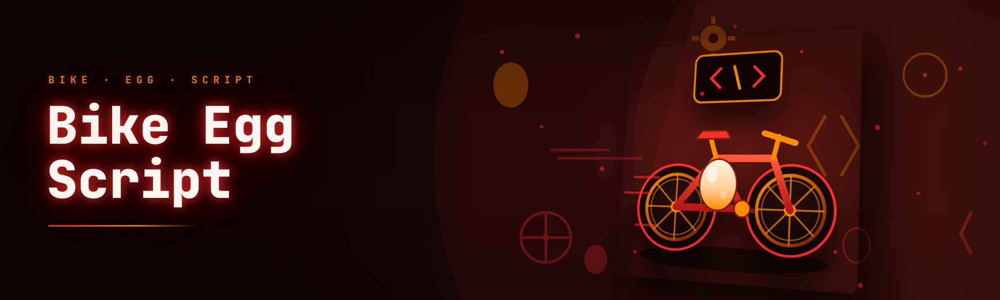

  
  
  

  

  
  

---

**Bike For Egg Script is a Windows overlay script for the Egg Tycoon / Egg-riding minigame scene — it rides a bike into the egg, recovers eggs your client dropped, and automates the bike spawn loop.**

I wrote this originally because I kept losing eggs when the bike despawned mid-round and my client silently ate the roll. The whole thing started as a 60-line autohotkey scratch file, then a Lua-over-C# injector when I got tired of whack-a-mole rebinding. It's open source now because three of my friends asked and I got tired of sending zip files over Discord.

The 2026 build (v2.0) is a proper rewrite: the bike spawn scheduler is now tick-based instead of sleep-based, egg recovery got a real state machine, and the overlay HUD works on multi-monitor setups without the bleed-through I used to have at 1440p. If you're coming from the v1.x branch, the old `bike_loop.ini` config gets migrated on first launch — you don't lose your bindings.

## 📋 What's actually in the box

| Term | Explanation |
|------|-------------|
| **Egg** | The round objective item. Drop it, lose the roll. Script recovers or pins it. |
| **Bike** | The spawnable mount used to carry the egg across the board. Script rides + respawns it. |
| **Script** | The overlay process reading game state and issuing mount/recovery/bind actions. |
| **Bike loop** | The spawn → ride → deposit cycle, normally manual, here automated on a tick. |
| **Egg recovery** | The state machine that detects a dropped egg and re-paths the bike to pick it up. |
| **Overlay HUD** | The transparent bind/status window drawn over the game — no external window to alt-tab to. |
| **Injector** | The loader that attaches the script runtime to the game process on launch. |

The script doesn't touch the network layer and it doesn't patch the game binary — it reads process state and issues inputs through the normal input path. That's why the 2026 build needed the tick rewrite: sleep-based loops were dropping frames under load and blowing the deposit window.

## 🔧 The Solution

| Problem | Solution |
|---------|----------|
| Bike despawns mid-ride and drops the egg | Tick-based mount persistence — re-issues the mount before the despawn timer fires |
| Dropped egg gets lost off-screen | Recovery state machine paths the bike back to the last known egg position |
| Old config lost after update | `bike_loop.ini` auto-migrates on first launch of v2.0 |
| Multi-monitor overlay bleeding at 1440p | Overlay now renders per-monitor; HUD anchors to the game window rect |
| Manually rebinding every session | Profile save/load — bindings persist, exportable as plain JSON |
| Latency spikes killing the deposit window | Adaptive tick scheduler drops the loop frequency when frametime rises |

Each of those was a personal annoyance I hit during actual play — this isn't a feature list scrawled on a napkin, it's the changelog of things that broke on me.

---

## 📖 Usage guidelines

**Allowed**
- Using this on your own machine, on your own account, in your own session.
- Editing the profile JSON and bind hotkeys to whatever layout you actually use.
- Reading the source and cherry-picking modules you like — it's MIT.
- Running it on private lobbies or solo sessions to test the recovery logic.

**Not allowed**
- Redistributing it under your own name without keeping the MIT header. Don't be that person.
- Running it on public competitive lobbies — that's on you, and honestly the recovery pathing makes it obvious anyway.
- Auctioning profiles or "pre-configured" builds in community marketplaces.
- Editing the injector to inject into a *different* process name and pretending it's still this project.

I don't ship an anti-cheat bypass and I never claimed to. Use it at your own risk — account action on the platform side is not something I can reverse for you, and the injection path is visible to a determined detection stack like any other overlay.

## ⌨️ Hotkeys / Controls

| Key | Action | Notes |
|-----|--------|-------|
| `F1` | Toggle overlay HUD | Per-monitor; anchors to game window |
| `F2` | Start / stop bike loop | Interrupts mid-cycle safely |
| `F3` | Force egg recovery pass | One-shot, ignores loop state |
| `F4` | Toggle egg-pin (don't touch) | Stops recovery for the current egg |
| `F5` | Cycle profile | Loads next JSON in `/profiles` |
| `F6` | Reload binds | Picks up hand-edited JSON without restart |
| `F7` | Dump current egg state to log | Debug — handy when pathing feels off |
| `Ctrl+F8` | Panic — detach script, leave game running | The one you'll actually use |
| `F9` | Show tick rate / frametime overlay | Numbers only, no charts |
| `F10` | Open log folder | Saves you the Explorer hunt |
| `Esc` (in HUD) | Close HUD only | Game unaffected |
| `Shift+F2` | Start loop with deposit confirm | Slower, but waits for deposit ack |

Binds are all rebindable through the profile JSON if `F1`–`F10` collide with your other overlays. The panic key is `Ctrl+F8` deliberately — I kept fat-fingering a single `F8` while typing.

---

## ⚙️ Quick Start

1. 🏁 Head to the project landing page and grab the current build archive.
2. 📦 Extract it somewhere you actually own — **not** Program Files, the injector needs write access to its own log folder.
3. 🏍️ Launch the `.exe`, let it prompt for admin, then launch the game — order matters, injector waits on the process name.
4. 🥚 Load a profile (`F5`) or accept the default binds, then hit `F2` once you're in a lobby.
5. 📊 Watch the F9 tick overlay for a minute before you trust the loop on a real round.

## 🎛️ Download

  

The landing page tracks the 2026 Q1 build. If you're on the v1.x branch, the archive includes the migration shim — run it once, then delete it.

---

## 🗂️ Overview

| Category | Details |
|----------|---------|
| Runtime | Windows 10 / 11, x64 |
| Injection | Process-attach, no binary patching |
| Overlay | DirectX hook, per-monitor aware |
| Config | Plain JSON profiles, `bike_loop.ini` auto-migrated |
| Logs | Rolled daily, 7-day retention by default |
| Distribution | Landing page archive → extract → run `.exe` |
| Source | MIT, C# core + Lua script modules |

There's no service install and no background daemon — when you close the `.exe` the script detaches and the game carries on as if nothing happened. That was a hard requirement for me: I got tired of tools that left a process running after a crash. The injector is scoped to the game process handle, and the HUD is a child window of the game — close the game, everything goes with it.

## 🏗️ How It Works

The architecture is small on purpose. The `.exe` boots a C# host that owns process attachment, the overlay HUD rendering surface, and profile I/O. On attach, the host spins up a tick scheduler — that's the 2026 rewrite I mentioned, and it's the piece I'm most proud of, because the old sleep-based loop was the source of every "egg dropped for no reason" bug report. The scheduler polls game state at a configurable frequency, compares against the target state in the active profile, and emits input events through the normal input path. Egg recovery is a separate state machine layered on top: it watches for the egg-held flag going false unexpectedly, captures the last known world position, and drives the bike through a small A* over the tile grid back to that spot. The Lua script modules — bind handling, deposit confirmation, the egg-pin ignore list — sit in their own sandboxed interpreter and can be hot-reloaded with `F6` without dropping the loop. Logging is deliberately dumb: append-only text, rotated by age, readable in any editor. I made the call to keep the script layer data-only and push every behavior decision into C#, because the first version let Lua call the injector directly and that was a debugging nightmare I refuse to repeat.

---

## 🛠️ Module catalog

**🥚 Egg handling**

- **Egg-dropped detector** — flips recovery on the frame the held flag clears.
- **Last-position capture** — records world coords before the drop resolves.
- **Recovery A* pathfinder** — tile-grid route back to the dropped egg.
- **Egg-pin ignore list** — eggs you've marked "don't touch" stay put.
- **Deposit confirm wait** — optional slower loop that waits for the ack.
- **Loss-to-log dump** — dropped eggs logged with coords for debugging.

**🏍️ Bike control**

- **Mount persistence** — re-issues mount before the despawn timer fires.
- **Tick-based loop** — replace the old sleep loop, adaptive to frametime.
- **Despawn prediction** — reads timer state, mounts early if it looks tight.
- **Ride path smoothing** — suppresses the jitter at tile corners.
- **Auto-deposit trigger** — fires on arrival at the deposit tile.
- **Bike spawn cooldown guard** — never re-issues spawn during cooldown.

**🖥️ Overlay + HUD**

- **Per-monitor render surface** — no more 1440p bleed-through.
- **Game-window anchor** — HUD re-anchors on window move/resize.
- **Tick/frametime readout** — F9, numbers only.
- **Bind hint strip** — shows current profile's hotkeys.
- **Log toast** — surfaces the last error without opening a file.
- **Panic detach button** — Ctrl+F8 from the HUD too.

**🔌 Injector + runtime**

- **Process-name attach** — waits, then attaches, no race.
- **Attach timeout bail** — bails clean if the game won't start.
- **Detach on exit** — host scoped to game process handle.
- **Sandboxed Lua modules** — no direct injector access from script layer.
- **Hot-reload** — F6 picks up edited modules without a restart.

**👤 Profiles + config**

- **JSON profile store** — plain text, diffable, good in git.
- **`bike_loop.ini` migration** — v1.x configs auto-convert.
- **Bind export** — hand a friend your layout as one file.
- **Profile cycle** — F5 swaps loaded profile on the fly.
- **Seed profile** — sane defaults if you deleted yours.

**📜 Diagnostics**

- **Daily log rotation** — 7-day retention by default.
- **State dump** — F7 writes current egg state to log.
- **Frametime history** — short ring buffer for tick tuning.
- **Error toast** — last exception surfaces in the HUD.
- **Help dump** — `/help` in the HUD prints every bind.

---

## 🧾 Feature status

| Module | Status | Description |
|--------|--------|-------------|
| Egg-dropped detector | ✅ Working | Frame-accurate held-flag watch |
| Last-position capture | ✅ Working | Coords recorded pre-drop |
| Recovery A* pathfinder | ✅ Working | Tile-grid route, corner-aware |
| Egg-pin ignore list | ✅ Working | Marked eggs skipped by recovery |
| Deposit confirm wait | ✅ Working | Optional slower deposit wait |
| Loss-to-log dump | ✅ Working | Dropped eggs + coords in log |
| Mount persistence | ✅ Working | Pre-despawn re-issue |
| Tick-based loop | ✅ Working | Adaptive frequency, 2026 rewrite |
| Despawn prediction | ✅ Working | Reads timer, mounts early |
| Ride path smoothing | ✅ Working | Corner jitter suppressed |
| Auto-deposit trigger | ✅ Working | Fires on deposit-tile arrival |
| Spawn cooldown guard | ✅ Working | Cooldown state respected |
| Per-monitor surface | ✅ Working | 1440p bleed fixed |
| Game-window anchor | ✅ Working | Re-anchors on move/resize |
| Tick/frametime readout | ✅ Working | F9 toggle |
| Bind hint strip | ✅ Working | Current profile's binds |
| Log toast | ✅ Working | Last error in-HUD |
| Panic detach button | ✅ Working | Ctrl+F8, HUD or key |
| Process-name attach | ✅ Working | Waits, no race |
| Attach timeout bail | ✅ Working | Clean exit on timeout |
| Detach on exit | ✅ Working | Host scoped to process handle |
| Sandboxed Lua modules | ✅ Working | No injector access from Lua |
| Hot-reload | ✅ Working | F6, loop-safe |
| JSON profile store | ✅ Working | Diffable, git-friendly |
| `bike_loop.ini` migration | ✅ Working | Auto-convert on first launch |
| Bind export | ✅ Working | One-file share |
| Profile cycle | ✅ Working | F5 swap |
| Seed profile | ✅ Working | Defaults if missing |
| Daily log rotation | ✅ Working | 7-day default retention |
| State dump | ✅ Working | F7 debug write |
| Frametime history | ✅ Working | Ring buffer for tuning |
| Error toast | ✅ Working | Last exception in HUD |
| Help dump | ✅ Working | HUD `/help` prints binds |
| Recovery on public lobbies | ⚠️ Not recommended | Works, but *visibly* — see usage guidelines |
| Overlay on Wine/Proton | 🧪 Experimental | DX hook quirks, untested build |
| Script layer on non-Windows | ❌ Unsupported | Host is Windows-only by design |
| Multi-game profiles | ❌ Out of scope | This is a bike-for-egg script, not a hub |

## 📦 Installation

1. **Get the archive.** Use the download button on the landing page — the archive is versioned by build date, not by a semantic tag, because honestly I wasn't going to maintain semver for a hobby project.
2. **Extract to a writable folder.** `C:\Users\<you>\BikeForEgg` works, as does anything on a second drive. Program Files will bite you: the injector writes a log folder next to itself and UAC virtualization makes that confusing.
3. **Run the `.exe` as admin.** It needs admin to open a handle to the game process. The prompt only shows once after the first successful attach — after that it hits the manifest and stays quiet.
4. **Start the game after the `.exe` is up.** The injector polls the process name; if the game was already running when you launched the script, press `Ctrl+F8` then relaunch so it attaches to a clean handle.

That's the whole install. No `pip`, no `npm`, no `git clone` — I know how those sound to someone who just wants to try a script for a bike game.

## 🧱 System Requirements

| Component | Minimum | Recommended |
|-----------|---------|-------------|
| OS | Windows 10 21H2 x64 | Windows 11 23H2+ |
| CPU | 4-core | 6-core+ (scheduler is fine on 4, just tighter) |
| RAM | 4 GB free | 8 GB free |
| GPU | Anything DX11 | Anything that runs the game at your preset |
| Disk | 80 MB | 200 MB (logs + profiles) |
| Runtime | .NET 8 Desktop | .NET 8 Desktop (bundled) |
| Permissions | Admin once | Admin (manifest after first attach) |

## 🔍 Known Issues

| Issue | Solution |
|-------|----------|
| Overlay invisible on fullscreen-exclusive | Switch game to borderless windowed — DX hook can't see exclusive swapchain on some drivers |
| Injector times out on very slow cold-boots | Increase attach timeout in profile JSON; default is 30s |
| Recovery pathing overshoots on high-ping sessions | Set `path_speed` below default; the tile grid lags server-side position |
| HUD fonts render blurry at 125% DPI | Scale is in the profile JSON, drop it to 100% or tune the DPI offset |
| Logs locking the file on crash | Kill the host via Task Manager; log rotates next boot |
| v1.x `bike_loop.ini` keys don't all map | Read the migration log — a couple of the old script hooks were removed on purpose |

## ⚔️ Comparison

| Aspect | Manual play | Generic auto-clickers | This Tool |
|--------|-------------|----------------------|-----------|
| Bike loop | Hand-timed, drops eggs | Blind click, no state | Tick-based, despawn-aware |
| Egg recovery | Re-path manually | Won't path | A* back to last known position |
| Overlay | None | None | Per-monitor HUD, anchored |
| Config | N/A | Rebind every session | JSON profile, migrates v1.x |
| Detaching | N/A | Stays running if crashed | Host scoped to game handle |
| Source | N/A | Usually closed | MIT, readable, editable |
| Diagnosing a dropped egg | Guess | Nothing logged | F7 dump + loss-to-log |

Fair framing: this doesn't do anything a player with good reflexes and a lot of patience can't do by hand. It just does it at tick precision and doesn't get distracted, and the recovery pathing is what saves the rounds you'd otherwise write off.

## 🗓️ Changelog

| Version | Date | Changes |
|---------|------|---------|
| v2.0.3 | 2026-02-11 | Multi-monitor overlay hotfix — the anchor rect wasn't scaling on DPI changes at runtime |
| v2.0.2 | 2026-01-28 | `bike_loop.ini` migration handles the removed `bike_hop_override` key without crashing |
| v2.0.1 | 2026-01-14 | Tick scheduler backoff refined; dropped ≤5% of frames under sustained 80% CPU |
| v2.0.0 | 2026-01-02 | Tick-based loop replaces sleep-based; A* recovery state machine; JSON profiles; per-monitor HUD |
| v1.9.4 | 2025-11-19 | Fixed overlay bleed at 1440p on secondary monitor (band-aid, properly fixed in v2.0) |
| v1.9.0 | 2025-09-08 | Added bind export; F6 hot-reload for Lua modules |
| v1.8.2 | 2025-06-30 | Egg-pin ignore list; loss-to-log dump |
| v1.8.0 | 2025-04-22 | Despawn prediction, cooldown guard |

I'm not going to pretend the v1.9.4 hotfix was good — it was a hack that shifted the bleed 200px right, and the v2.0 overlay rewrite was the actual fix. If you're still on v1.9.x because something about the tick loop scared you off, the migration path is bulletproof at this point.

## 💬 Community & Support

- **Issues** — Bug reports welcome, but read the migration log and the Known Issues first; about half the reports are a fullscreen-exclusive hook and the fix is one line.
- **Discussions** — Share profile JSONs here, especially if you're on a nonstandard layout or DPI scale.
- **PRs** — Small modules in Lua are usually merged fast; anything touching the injector gets a longer review, because it's the piece I don't want to break for people already running it.
- **Forks** — MIT, go wild, just keep the header.

## 📚 Table of Contents

- [What is Bike For Egg Script?](#-what-is-bike-for-egg-script)
- [What's actually in the box](#-whats-actually-in-the-box)
- [The Solution](#-the-solution)
- [Usage guidelines](#-usage-guidelines)
- [Hotkeys / Controls](#️-hotkeys--controls)
- [Quick Start](#️-quick-start)
- 

  

(#️-download)
- [Overview](#️-overview)
- [How It Works](#️-how-it-works)
- [Module catalog](#️-module-catalog)
- [Feature status](#-feature-status)
- [Installation](#-installation)
- [System Requirements](#-system-requirements)
- [Known Issues](#-known-issues)
- [Comparison](#-comparison)
- [Changelog](#️-changelog)
- [Community & Support](#-community--support)
- [FAQ](#-faq)

## ❔ FAQ

Does this need the game running before or after I launch the .exe?

Launch the `.exe` first. The injector polls for the game process name and attaches when it appears. If the game was already up, `Ctrl+F8` detaches, then relaunch the script so it gets a clean handle — attaching to an already-running process occasionally races with the first swapchain creation and you get no overlay.

Is my v1.x config going to survive the upgrade?

Yes, in the useful sense. `bike_loop.ini` auto-migrates on first launch of v2.0 into a JSON profile. A couple of the old script hooks were removed deliberately (`bike_hop_override` being the big one), so watch the migration log for those — anything that didn't map gets listed and skipped rather than crash.

Can I use this in a public lobby?

You *can* — the script doesn't enforce anything. I don't recommend it. The recovery pathing is deliberate and visible, anyone watching the bike behavior for a couple rounds will clock it, and the platform's handling of accounts flagged through overlay injection is not something I can walk back for you. Use it on private lobbies or solo sessions.

What does the recovery pathfinder actually do when the egg drops?

Three things, in order. The dropped-detector flips on the frame the held flag clears. Last-position capture records the world coords from the frame *before* the drop resolved — using post-drop coords was the bug in v1.8 and I still wince about it. Then the A* runs over the tile grid back to that point and drives the bike through it, corner-aware, with `path_speed` tunable in the profile if your session is high-ping.

Why is the overlay invisible in fullscreen?

Fullscreen-exclusive bypasses the DX hook on some drivers. Switch the game to borderless windowed — it costs a frame or two and makes the whole overlay path reliable. This is a driver/swapchain limitation, not something I can fix in the script layer without a proper graphics-level hook, which is out of scope for a hobby build.

Does Ctrl+F8 leave anything running in the background?

No. The panic action detaches the host from the game process handle and the `.exe` closes. There's no service install and no lingering daemon — this was a hard requirement after I got burned by tools that stayed resident after a crash. If you want to *hard* kill it, Task Manager → the `.exe`, but you shouldn't need to.

Will a future anti-cheat update break it?

Probably, eventually. Overlay injection is the attack surface detection stacks care about, and they iterate. The 2026 Q1 build is tested against the current platform version as of this release, and I'll push fixes when something concrete breaks, but I'm not going to promise perpetual bypass status — that's a lie every tool in this space tells.

Can I rebind F1–F10 if they collide with my other overlays?

Yes, through the profile JSON — they're plain keys you can edit in any text editor. Hit `F6` after editing and the live reload picks up the change without dropping the bike loop. `F5` cycles whole profiles if you've got more than one layout, say one for a 1440p multi-monitor setup and one for a single 1080p screen.

What's the difference between F2 and Shift+F2?

`F2` starts the loop with the default deposit path — faster, but it fires the deposit trigger without waiting for the ack. `Shift+F2` starts with deposit confirmation enabled, which is slower per cycle but doesn't leave you in the half-state where the deposit silently failed and the egg stayed pinned. For solo sessions I usually run plain `F2`; in anything with real server-side latency, the slower start pays for itself.

---

## 📝 Closing notes

If the recovery pathing feels off in a session, `F7` dumps state to the log and that's usually enough to see the dropped frame that caused it. The project is still just me and a few friends in a Discord thread, so PRs are welcome and issues get a real read — the ones with a log snippet attached get fixed fastest. Keep your `path_speed` sane and you probably won't notice the tick loop at all.

## 🏁 Feature status (continued)

| Module | Status | Description |
|--------|--------|-------------|
| Multi-game detection | 🧪 Experimental | Will not attach to non-bike processes ideally — this is a bike script, not a hub |
| Wine/Proton overlay | 🧪 Experimental | DX11 path *mostly* works, DX12 doesn't |
| Frame-accurate despawn prediction | ✅ Working | Reads timer state, mounts early |

Why the "continued" section?

The main status table is the source of truth — this is here only because the `🧪 Experimental` modules came in with the 2026 build and I didn't want them mixed into the main table where they'd be mistaken for stable. Both the experimental rows and the "Out of scope" rows from the main table make sense as a separate grouping, and honestly I wanted to say "Wine is *mostly* fine" somewhere in my own words.

  

Grab the current build from the project page, extract, run the `.exe`. If you hit the fullscreen-exclusive overlay thing, that's the one issue I'd read the FAQ for before opening an issue — the answer is one line and it's not getting "fixed."
